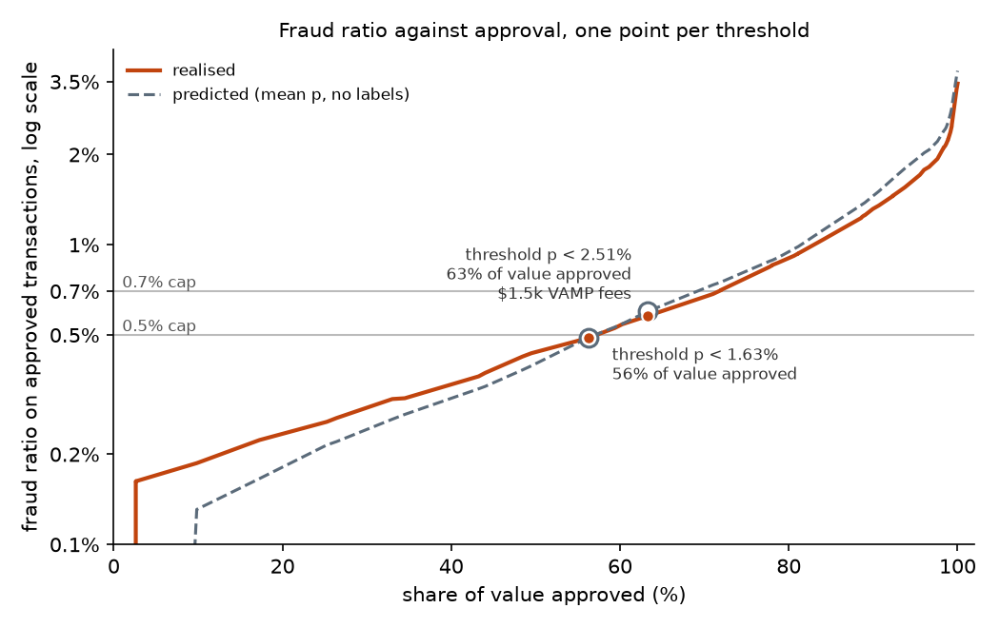
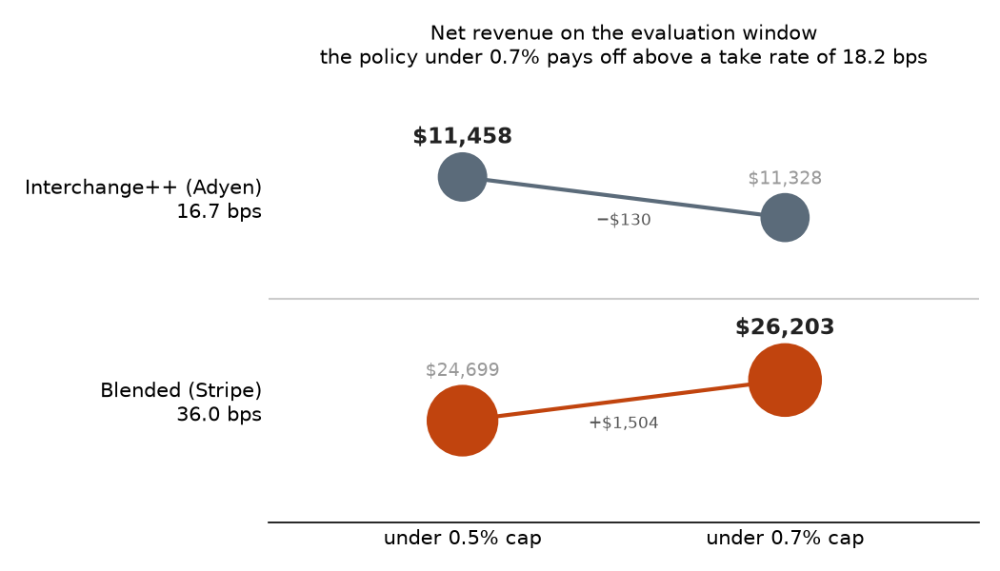

# Approve or Decline, Under the VAMP Cap

**Setting a card-fraud decline threshold for a payment provider's merchant portfolio to keep Visa's fraud monitoring ratio under its cap.**

SQL · Python (LightGBM, scikit-learn, pandas) · UV · Jupyter / matplotlib · pytest

---

## Who pays for card fraud

When a shopper pays by card online, the payment passes through several hands before the money reaches the merchant. The **merchant** sells the goods. A **payment service provider (PSP)**, such as Adyen or Stripe, takes the card details at checkout, sends them to be authorised and settles the funds. Many PSPs are also the **acquirer**: the party that holds the merchant's relationship with the card networks and is answerable to them for it. The **issuer** is the cardholder's bank: it approves or refuses each authorisation and raises disputes on the cardholder's behalf. **Visa** runs the network between issuer and acquirer, and its monitoring programme, the subject here, holds acquirers and their merchants to account, not issuers.

Card-not-present fraud is a payment made online with stolen card details. It comes to light when the real cardholder disputes the charge with the issuer, which can be the same day if they notice at once, or weeks later when the statement arrives. The dispute becomes a **chargeback**. The issuer takes the full amount back from the acquirer through Visa; the acquirer then debits the merchant, together with a chargeback fee. Practice varies on the commission: some PSPs refund it and debit only what they paid out on the sale, others keep it. This project assumes the first, the cautious case, in which a charged-back fraud earns the PSP nothing. The goods are usually gone. Visa gives the issuer up to 120 days from the transaction to raise a fraud dispute, and Vesta's labels in the data below use the same window, so whoever decides whether to approve a payment decides long before learning whether it was fraud.

The parties do not stand to lose the same thing. The merchant bears the fraud loss. The PSP keeps a small share of every approved dollar, its take rate. It can price each merchant differently, so across a portfolio the take rate is an average, not one commission on every sale. Every decline costs it revenue. But as acquirer it answers to Visa for the fraud across its whole portfolio, every merchant it serves at once. This project takes the seat of an analyst at such a PSP and asks one question: how many transactions can it approve while keeping its portfolio inside Visa's monitoring thresholds?

The setting is the United States, and every amount is in dollars. Unlike in the EU, where PSD2 makes strong customer authentication mandatory, 3D Secure is optional there, so a PSP may approve a card-not-present payment without challenging the cardholder. This project leaves authentication out: every transaction is either approved or declined.

## Visa's monitoring ratio

Each card network runs its own monitoring programme, with its own ratio and thresholds. This project works against Visa's because Visa is the largest network in the US and carries 65% of the transactions in this data, against 32% for Mastercard and about 2.5% for American Express and Discover together. Since 2025 its programme has also counted fraud and disputes in a single ratio, with published thresholds and per-event fees. The ratio here is computed over all approved traffic, as if every card were a Visa card.

Since 1 April 2025 Visa has monitored fraud and disputes under one programme, the Visa Acquirer Monitoring Program (VAMP). Its measure is a monthly ratio of counts, not amounts:

**VAMP ratio = (fraud reports + disputes) ÷ settled card-not-present transactions**

A fraud report is the issuer's notice to Visa that a transaction was fraudulent; a dispute is a chargeback the issuer has raised. Visa computes the ratio for each merchant and, over the whole portfolio, for each acquirer, with separate thresholds for the two. The acquirer thresholds are the ones this project works against:

| Acquirer ratio | Level            | Fee per counted event | The acquirer                                                                                                        |
| -------------- | ---------------- | --------------------- | ------------------------------------------------------------------------------------------------------------------- |
| under 0.5%     | not flagged      | none                  | —                                                                                                                   |
| 0.5% – 0.7%    | *Above Standard* | **$4**                | Must show enhanced dispute management                                                                               |
| above 0.7%     | *Excessive*      | **$8**                | Visa may review merchants and payment facilitators directly and expects the worst to be acted on, up to termination |

Crossing the 0.5% line does not price the excess alone: every event in the month is charged, including those the portfolio already had under the line.

## The decision, and the theory behind it

The project works in two steps. First, a machine-learning model is trained on past transactions to estimate, for each one, the probability that it is fraud. The history is cut into three consecutive periods: the model learns from the first, its probabilities are adjusted on the second so they can be read at face value, and everything is judged on the third, a month the model never saw. Second, that probability is turned into a decision, and the decision is where this project's question lies.

A fraud model decides nothing by itself. It gives each transaction a score, and a policy turns the score into an action. The policy here is the simplest there is: **approve if `p < t`, decline otherwise**, where `p` is the model's probability that the transaction is fraud and `t` is one threshold for the whole portfolio. Choosing `t` is the deliverable.

Two caps hold the PSP back, in different ways. Under 0.5% it pays Visa nothing. Between 0.5% and 0.7% it may stay if it accepts the fees. Above 0.7% the fee doubles and Visa may act against its merchants directly. The problem is therefore a constrained one rather than a trade-off of costs: **under each cap, approve as much legitimate value as possible while the actual fraud ratio of the approved traffic stays under it**, then compare the two answers in dollars.

From the PSP's seat, raising the threshold approves more legitimate value and so earns more of its take rate; for the merchant, every extra fraud approved is goods lost. Visa's fees change the picture only at the 0.5% line. The first policy over it pays $4 on every approved fraud, including all those it already approved under the line, so net revenue falls once, by that whole sum, and then rises again as further approvals bring in more than the $4 each new fraud costs, as they do on this data. Whether the 0.7% policy ends ahead of the 0.5% one therefore depends on the take rate.

The threshold under each cap is chosen on the actual fraud outcomes of the evaluation month: the highest one whose approved traffic stays under the cap. Under 0.7%, the more dangerous line, the model's forecast of the ratio, made before any outcome is known, must stay under the cap as well. That rules out the last step under the line and selects the one below it. Revenue plays no part in either choice. It is computed afterwards, as the take rate on approved legitimate value less Visa's fees, so that the two caps can be compared in dollars.

## The data

IEEE-CIS Fraud Detection, released on Kaggle by Vesta, a US provider of card-not-present fraud prevention: 590,540 labelled transactions over 183 days, 3.5% of them fraud, with card, address, email-domain, device and behavioural features. It pools many merchants' traffic without naming them, which is what a PSP's portfolio looks like from the inside. The fields are obfuscated, as payments data usually is: `card1`, `card2`, `card3` and `card5` are anonymised codes rather than card numbers; only `card4` (network) and `card6` (debit or credit) are legible, and the 339 `V*` columns are Vesta's own engineered features stripped of their names. This is not a quirk of the competition. PCI DSS restricts where primary account numbers may travel, so a payments analytics layer works on tokenised or masked data as a matter of course, and analysts rarely see a card number at all.

Kaggle ships the data as a training and a test set, each split into a transaction table and an identity table (device and browser details, present for about a quarter of transactions). Only the training set is labelled: its `isFraud` column is 1 if the transaction turned out to be fraud and 0 if not. The test set's labels were never released, so this project uses the training set alone, and the 590,540 transactions above are all of it.

## How it works


### Part 1 — The model

**The model is a LightGBM classifier.** A classifier learns from past transactions whose outcome is known, here the `isFraud` label, and returns for each new one a score for how likely it is to be fraud. LightGBM builds that score from thousands of small decision trees, each a short sequence of yes/no questions about the columns: is the amount over $500? has this card paid more than five times today? The trees are grown one after another, each fitted to the errors the previous ones still make, and the score adds up their answers. This technique, gradient boosting, is the usual choice for tabular data like this: it handles hundreds of mixed columns and missing values without preparation.

A raw model score is a *ranking*: higher means riskier, but among transactions scored 0.8 the share that is fraud might be 0.6 or 0.95. A **calibrated probability** is a forecast: of the transactions given 2%, about 2% turn out to be fraud. That is what the threshold is set on: `t` is one of these probabilities, so the policy reads as "decline every transaction at least `t` likely to be fraud". 

The labelled transactions are divided into three consecutive windows: train, calibrate, evaluate. 
**The probabilities are calibrated** on the second window of the split, with the isotonic regression technique, which maps the score onto a step function. Therefore, many transactions share each probability, and each distinct value is a candidate threshold for the following Part 2. The calibration plot is in `notebooks/results.ipynb`.

The model is tested in the evaluate window, the third one, which is affected by an observed fraud ratio of 3.45%: this is a high-risk book, and keeping it compliant is expensive.

The split must be chronological, never random, because of how the labels were built. A reported chargeback marks a transaction as fraud, and so are later transactions linked to the same account, email or billing address. Fraud labels therefore cluster by entity. A random split places the same fraudster on both sides, and the model learns to recognise people rather than patterns. 

### Part 2 — Setting the threshold

The calibrated probability takes 152 distinct values on the evaluation window, so there are only 153 distinct policies: approve nothing, approve everything, and one cut between each pair of adjacent values. All of them are evaluated. For each one the realised outcome is a running sum over transactions sorted by probability — approved count, approved fraud count, approved legitimate and fraudulent value.

The PSP earns through a share of the value of each order it approves, what it keeps per dollar processed. Its revenue derives from that amount summed over every approved legitimate order, which we calculate as the PSP's take rate, in percentage, times the total approved legitimate value. An approved fraud earns nothing, because the sale is reversed when the chargeback arrives. As we raise the threshold, both approved legitimate value grow, as well as the fraudolent traffic (approved or declined). Hence, under each cap, we push up the threshold (to gain more profits) until the fraud ratio of the approved traffic is close to the cap, but below it. The take rate plays no part in that choice. It only puts a dollar figure on each policy, in revenue earned and revenue forgone.

**Two take rates, one per pricing model.** What a PSP keeps from approved value is its *net* take rate: what the merchant pays, less interchange to the card issuer and scheme fees to Visa, both passed straight through. How much that is depends mostly on which pricing model the PSP's merchants are on. Large merchants pay interchange++, the pass-through costs at cost plus a negotiated markup, and Adyen, whose book is mostly enterprise, keeps 16.7 basis points. Smaller merchants pay a blended flat rate such as 2.9% + 30¢, which bundles the same costs with a wider margin, and Stripe keeps about 36. Every cap is priced at both; 

VAMP fees are subtracted from that revenue. Each approved fraud is one counted event, charged at the fee of the highest level the realised ratio is over: nothing under 0.5%, $4 up to 0.7%, $8 beyond. Fees jump when a line is crossed, and that is what makes the two caps worth comparing. The policy under the 0.5% cap approves the most value that can be approved without paying Visa anything. The policy under the 0.7% cap approves more, but its ratio is over 0.5%, so it pays $4 on every fraud it approves.

Inside a fee band, fees could in principle pull the threshold down. Take the policies whose realised ratio lies between 0.5% and 0.7%: every one of them pays the same fee on every fraud it approves. Moving from one of them to the next is one isotonic step up the threshold, and it approves the transactions that share the next probability value: some more legitimate value and, sometimes, some more fraud. The isotonic step raises net revenue only if the take rate earned on the legitimate value it adds is larger than the fees on the frauds it adds. Put the other way, the take rate must be above fee × frauds added ÷ legitimate value added, to make an isotonic step gain more profits. 

On this window 14 isotonic steps sit in the band. Twelve add legitimate value alone. The other two add fraud, and they pay for their fees at any take rate above 5.1 and 3.9 bps respectively. Therefore, only a PSP earning less than 5.1 bps would do better with a policy further down the band. Above 5.1 bps, every step up let us earn more money. 

Both take rates priced here, 16.7 and 36 bps, are far above 5.1. On this window, then, no policy in the middle of the band earns more, net of fees, than those close to the 0.7% cap: pushing the threshold up to the cap is the most profitable choice inside the band, at either take rate. The steps are listed in `notebooks/results.ipynb`, and the test file checks the rule against a brute-force search for the best net revenue in the band.


## The finding

On the evaluation window (89,614 transactions over 31 days):

| Cap                           | Threshold | Approved (count / value) | Fraud ratio, realised / predicted | Fraud value let through | VAMP fees        |
| ----------------------------- | --------- | ------------------------ | --------------------------------- | ----------------------- | ---------------- |
| 0.5%, acquirer Above Standard | 0.016347  | 68.7% / 56.2%            | 0.49% / 0.49%                     | 8.1%                    | —                |
| 0.7%, acquirer Excessive      | 0.025078  | 74.5% / 63.2%            | 0.58% / 0.60%                     | 11.2%                   | $1.5k (386 × $4) |

The threshold addressing the lower cap is about 1.6%. That sounds strict, but nobody chose it; the cap did. The cap applies to the approved traffic as a whole, whose fraud ratio is roughly the average probability of what is approved. As a result, a 0.5% cap on fraud ratio leads to an average probability of fraud close to 0.5%, which in turn entails a threshold going not too far over the 1% value.

The threshold addressing the 0.7% policy could rise at most to 0.025707, with a realised fraud ratio of 0.69%. That score was not taken, for two reasons:
- The main one is what lies past 0.7%. There the fee doubles to $8 on every event, and Visa may review the PSP's merchants directly and expect the worst of them to be offboarded. A policy with no margin under that line is one that a slightly worse month tips into Excessive; 
- The second reason is how the PSP sees the policy. The realised 0.69% is known only once the chargebacks are in, much later, while the predicted ratio, its forecast of the same traffic on the day, reads 0.73%, already over the cap. 
For these reasons, rather than picking the last policy under the 0.7% cap, I opted for a lower threshold, sitting on the score of 0.025078, keeping also the predicted ratio under that ceiling And most importantly, let the payment provider work not too close to this upper and more dangerous limit.

All this is displayed in the following image, generated, with matplotlib, in `notebooks/results.ipynb`:



The curve is traced by moving the threshold through all 153 candidate values: each point is one policy, plotted as the share of value it approves against the fraud ratio of what it approves. Each cap is a horizontal line, and the policy chosen under it is labelled with its threshold on the fraud probability, the share of value it approves and any VAMP fees incurred; nothing on the figure depends on the take rate. 

The dashed line is the predicted ratio, the mean probability of the same approved traffic, computed without a single fraud label from the dataset; the ring on it marks the chosen policy's predicted ratio. Above the 0.5% cap the dashed line runs above the solid one, because the model over-predicts there. That is why the predicted ratio crosses 0.7% one step before the realised one does

The two policies break even at a take rate of **18.2 basis points**, where the extra value earns exactly what the fees cost. An enterprise acquirer on interchange++ pricing, at Adyen's take rate of 16.7, should therefore stay under 0.5%. A blended-rate acquirer, at Stripe's take rate of 36, should run the portfolio in Above Standard and pay the fees (in other words, one fee band can cancel a 7-point gain in approval for one PSP and not for another). All this is shown in the following figure:



Approving about two thirds of the traffic (as shown in the previous table) is the finding, not a defect to tune away. It is what a single decline threshold can afford when the portfolio's fraud runs seven times above the line it is held to. Model changes do move it, which is why approval at the cap, not PR-AUC, is the measure every model change is judged on here. A PSP in this position would not decline its way out. It would authenticate the grey zone instead of declining it (likely making use of 3D Secure), set thresholds merchant by merchant so that clean merchants are not held back by risky ones, and offboard the merchants driving the ratio. The data supports none of those three today, which is why they are the future work below.
## Assumptions

| Parameter | Source type |
|---|---|
| VAMP ratio definition and thresholds | Visa programme documentation, via published summaries |
| PSP take rates | Adyen reported results; Stripe's own reported volume, and its revenue as reported by *The Information*, a tech news outlet, and by analysts |
| Labelled fraud counted as VAMP events | Explicit assumption |

## Future work

- **3D Secure on the grey zone.** Authenticating the band just above the threshold, instead of declining it, keeps most of those sales and moves the fraud liability to the issuer. Pricing it needs challenge and abandonment rates, which a PSP observes in its own authentication logs and this dataset lacks. The natural design is a randomised test within that band.
- **Thresholds per merchant.** One threshold for a pooled portfolio makes clean merchants pay for risky ones. With a merchant identifier, each merchant gets its own cut, under the portfolio cap as a whole.
- **Offboarding.** The same identifier shows which merchants drive the ratio. Removing the worst few is often cheaper for the portfolio than declining a slice of everyone's traffic.
- **The EU case.** Under PSD2, strong customer authentication is mandatory and the threshold decides which transactions qualify for the Transaction Risk Analysis exemption, under fraud-rate ceilings of 0.13% up to €100, 0.06% up to €250 and 0.01% up to €500. It is the same constraint-driven problem with a regulator's caps in place of Visa's.

## Repository

```
├── README.md
├── assumptions.md             ← every parameter, sourced
├── scope-and-limitations.md   ← the seats not taken, what is left out, the limitations
├── model.md                   ← how much a random split would inflate the model
├── config.yaml                ← split boundaries, seeds, take rates, VAMP caps and fees
├── sql/
│   ├── README.md              ← what each query does, and why it is SQL
│   ├── 00_load_raw.sql
│   ├── 01_velocity_features.sql
│   ├── 02_entity_aggregates.sql
│   ├── 03_training_table.sql
│   ├── 04_split.sql
│   ├── 05_policy_curve.sql
│   ├── 06_policy_thresholds.sql
│   └── mart.sql               ← the data mart's tables
├── src/
│   ├── ingest.py              ← kagglehub → DuckDB
│   ├── features.py            ← runs sql/ in order
│   ├── split.py               ← chronological split views
│   ├── train.py               ← LightGBM + calibration
│   └── policy.py              ← threshold under each VAMP cap
├── data/                      ← gitignored, rebuilt by the pipeline
│   ├── manifest.json          ← the one committed file: provenance + checksums
│   ├── model_<seed>.txt       ← the fitted boosters, one per seed, written by train.py
│   ├── raw/fraud.duckdb       ← the dataset, and everything derived from it
│   └── mart.duckdb            ← one row per run: model metrics and the chosen thresholds
├── tests/
│   ├── test_sql_layer.py      ← validates sql/ on a fixture, no Kaggle account needed
│   └── test_policy_economics.py  ← the threshold rule against brute force
└── notebooks/
    ├── colab_setup.ipynb      ← reproducing the pipeline on Colab
    ├── results.ipynb          ← the figures, drawn from the database
    ├── thresholds.sql         ← the run's rows from the mart, read once by the notebook
    ├── band_steps.sql         ← the steps inside the fee band
    └── figures/
        └── tradeoff_curve.png
```

The data and the database are build artifacts, not repository contents. The IEEE-CIS
competition rules restrict redistribution, so the dataset is never vendored here and
the pipeline reproduces everything from a Kaggle token. `data/` is gitignored apart from some files like `manifest.json`, which records provenance without any of the data.

To see what the data looks like without downloading it, read `tests/test_sql_layer.py`:
its fixture reproduces the source schema and its awkward parts, and it runs without a
Kaggle account.

Only the labelled `train_*` files of the Kaggle dataset are fetched. The Kaggle test set has no released fraud labels, so it cannot support an evaluation on realised outcomes and is never downloaded.

Everything downstream of the CSVs lives in one DuckDB file: `raw_*` tables hold the
source verbatim, the feature tables are derived from them, the three split windows are
views over `training_table`, and `predictions` holds the calibrated probability the policy
reads from the evaluation window only. Each run of `train.py` stamps its
probabilities with a `run_id` and replaces the table.

Results go one step further, into a separate data mart, `data/mart.duckdb`, kept apart so that
rebuilding the main database never erases them. It holds one row per run rather than one per
transaction, and only aggregates: `model_runs` (PR-AUC, ROC AUC, Brier scores, the seeds and
the configuration they ran under) and `policy_thresholds` (the threshold under each cap, with
its approval, ratios and dollars), both keyed by `run_id`, so any chosen threshold traces back to the model that produced it and runs can be compared over time. This is the layer a BI tool would 
are the one thing kept outside DuckDB: they are not tabular, so they go to `data/model_<seed>.txt` in LightGBM's own text format, one per seed in `model.seeds`.

## Running it

Dependencies are managed with [uv](https://docs.astral.sh/uv/); `uv run` resolves the environment on first call, so there is nothing to activate.

```bash
uv run python src/ingest.py     # download the labelled CSVs, load them into DuckDB
uv run python src/features.py   # run the SQL feature layer in sql/, in order
uv run python src/split.py      # the three chronological split views
uv run python src/train.py      # LightGBM, calibration, probabilities for the policy
uv run python src/policy.py     # threshold under each VAMP cap
```

Run them in that order the first time. The order is the dependency chain, but the
stages are otherwise independent: each reads the database, writes to it and exits, so
any one can be re-run on its own without repeating the others.

| Stage | Script | What it does |
|---|---|---|
| 1. ingest | `src/ingest.py` | Fetches the labelled `train_*` CSVs through kagglehub, records sizes and checksums in `data/manifest.json`, loads them into DuckDB as `raw_transactions` and `raw_identity` |
| 2. features | `src/features.py` | Executes `sql/01`–`sql/03` in order, building `velocity`, `entity_aggregates` and `training_table`, then checks the row count is unchanged |
| 3. split | `src/split.py` | Runs `sql/04_split.sql` with the day boundaries from `config.yaml`: records them in `split_windows`, creates the `train_set`, `calib_set` and `eval_set` views, and rolls back if a window is empty or the three are not contiguous |
| 4. train | `src/train.py` | Fits one LightGBM booster per seed on `train_set`, averages their scores and calibrates the average on `calib_set`, writes the boosters to `data/model_<seed>.txt`, the evaluation window's calibrated probabilities to the `predictions` table, and the run's metrics to the mart's `model_runs` |
| 5. policy | `src/policy.py` | Runs `sql/05`–`sql/06`, building `policy_curve` (the realised outcome of every candidate threshold) and the highest threshold under each VAMP cap, priced in dollars and written to the mart's `policy_thresholds` |

`notebooks/results.ipynb` draws the figures from the database and the mart without writing
to either, so a change of style never means re-running a stage.

`src/train.py --random-split` refits the same model under a random partition to size the
leakage the chronological split avoids. It is a diagnostic and doubles the runtime, so it
is not part of a normal run. Its PR-AUC lands in the run's `pr_auc_random_split` column.

`ingest.py` needs a Kaggle token **and** acceptance of the competition rules at
[kaggle.com/c/ieee-fraud-detection/rules](https://www.kaggle.com/c/ieee-fraud-detection/rules)
— the API returns 403 until those are accepted in a browser, and no token substitutes
for that.

```bash
uv run pytest                   # both test files: the SQL layer and the threshold rule
uv run ruff check .
```

Neither test needs the dataset or a Kaggle account, so the window functions in `sql/` and the
threshold rule in `src/policy.py` can both be verified by anyone who clones this.

**Reviewing quickly?** The finding follows *How it works* and, for the engineering, `sql/01_velocity_features.sql` is the query worth reading, and `tests/test_sql_layer.py`
verifies it against a fixture without needing the data.

## Author

**Riccardo Conti**: 
Product Analyst | Financial Modeling, Subscription economics and Experimentation | SQL · Python
- LinkedIn: [linkedin.com/in/rick-conti/](https://www.linkedin.com/in/rick-conti/)
- Email: c.riccardo237@gmail.com
*Independent analysis. Not affiliated with Vesta, Visa, any card network, or any payment provider.*